# Nothing X

Desktop controls for Nothing and CMF audio devices on Linux, including a native COSMIC panel applet.

[Try the interactive demo](https://basanta.cc/nothing-x/) · [Download the latest release](https://github.com/basanta-bhandari/Nothing-x/releases/latest)

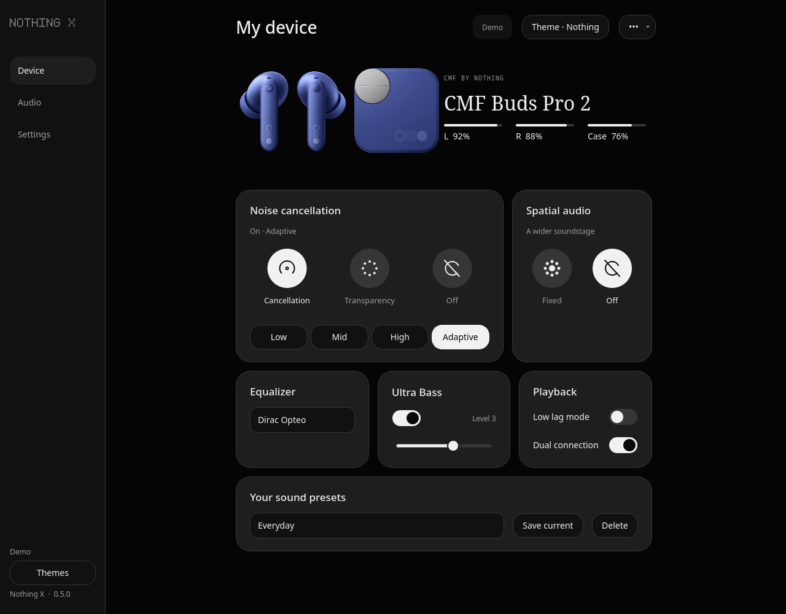

Nothing X is an unofficial desktop companion for the controls that usually live in the Nothing X mobile app. It began with CMF Buds Pro 2 on CachyOS/COSMIC and now has a shared interface for Nothing and CMF earbuds and headphones.

## What it does

- Change noise cancellation, transparency, equalizer, Ultra Bass, spatial audio, low-latency mode, and other device features when supported.
- View left, right, and case battery readings; case values stay visible as **Last reported** when the case is unavailable.
- Manage Bluetooth profiles, output volume and balance, microphones, and per-application routing through PipeWire.
- Save sound presets, choose from six themes, enable startup, and check for an update that matches the installed variant.
- Keep essential device controls and battery information in a compact COSMIC panel applet.

Feature availability depends on the connected model and its firmware. CMF Buds Pro 2 is the primary development device; other model profiles remain hardware-dependent.

## Demo and screenshots

The [browser demo](https://basanta.cc/nothing-x/) runs entirely with simulated device and audio data. It is useful for trying the navigation, controls, themes, and three example device profiles without installing anything.

| Device controls | Themes |
| --- | --- |
|  | 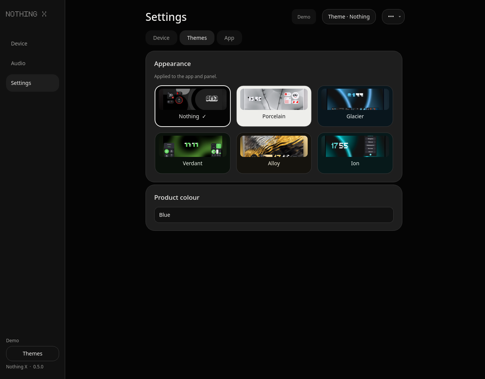 |

| Audio and routing | Headphone support |
| --- | --- |
| 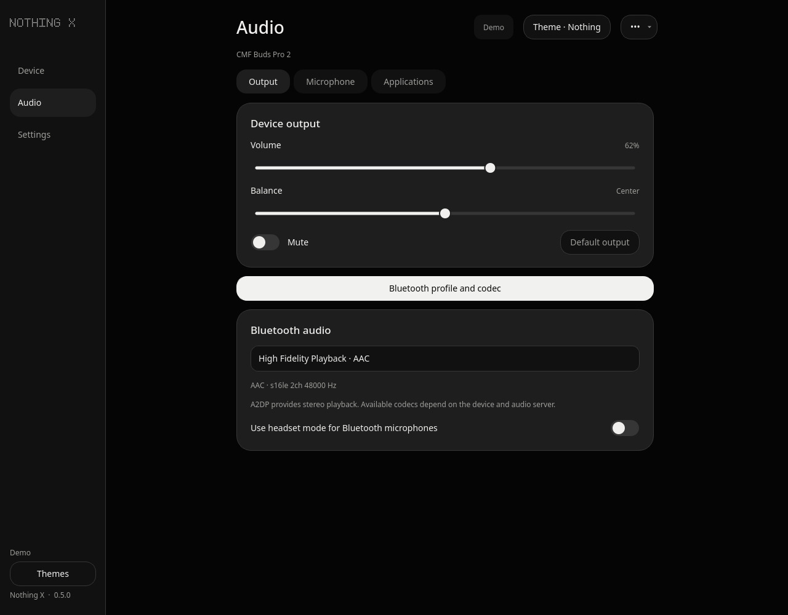 | 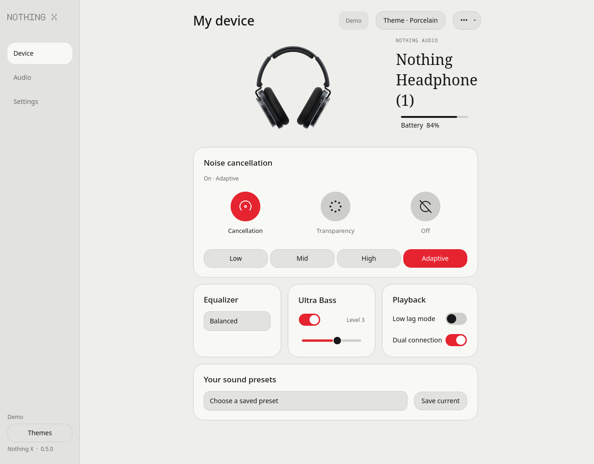 |

| Applications | Microphone |
| --- | --- |
| 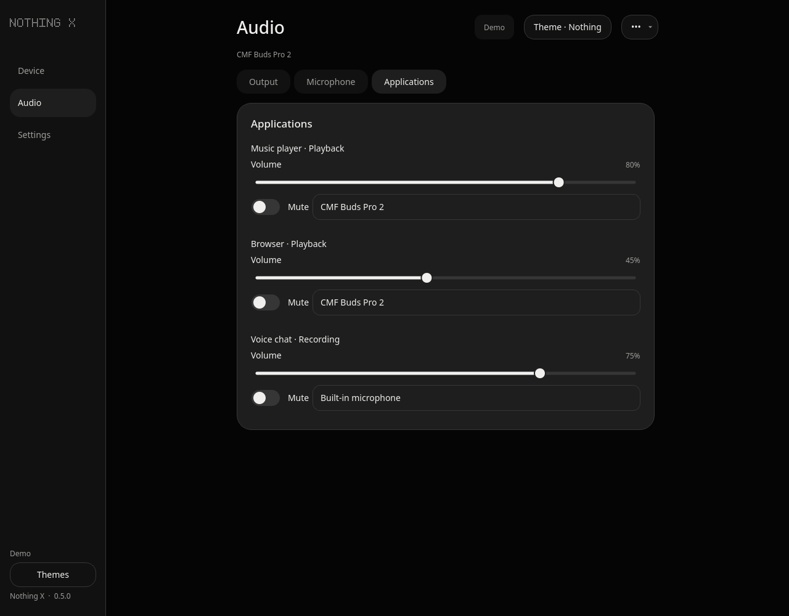 | 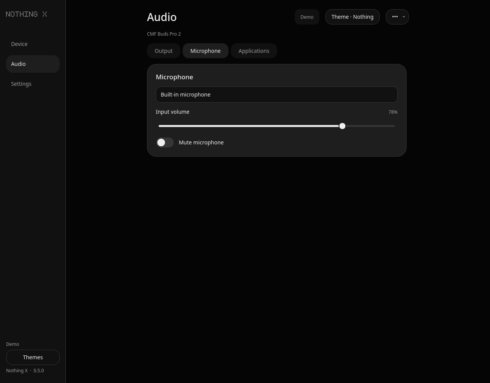 |

| Device preferences | Glacier theme |
| --- | --- |
| 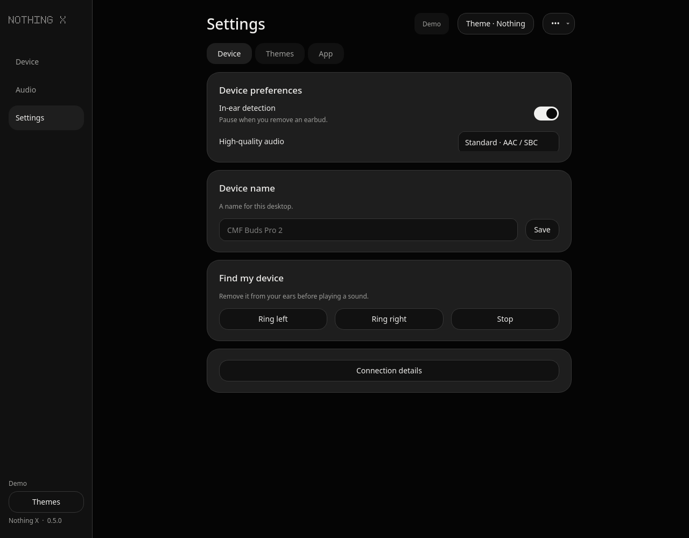 | 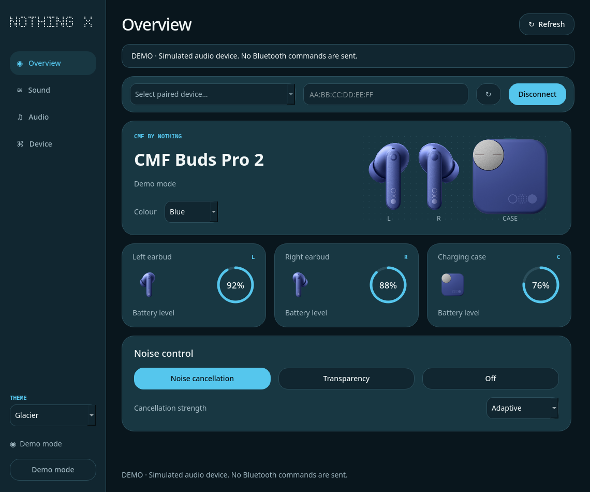 |

<details>
<summary>All six themes</summary>

| Nothing | Porcelain | Verdant |
| --- | --- | --- |
|  | 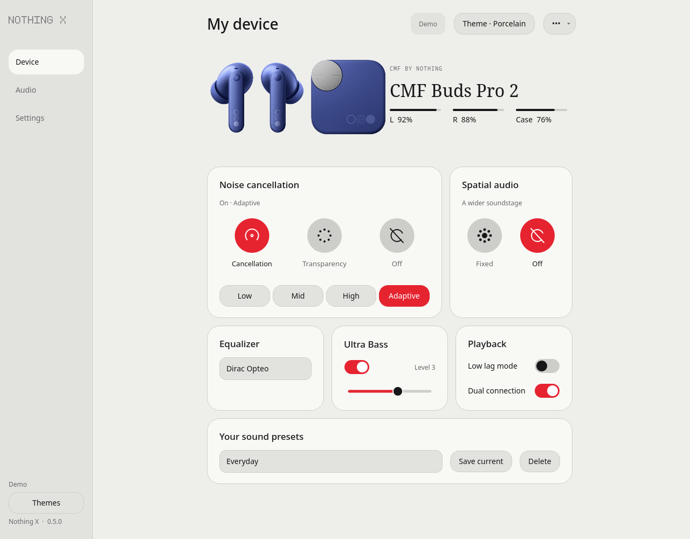 | 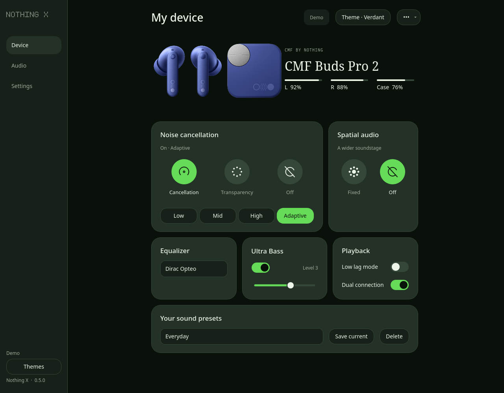 |

| Glacier | Alloy | Ion |
| --- | --- | --- |
|  | 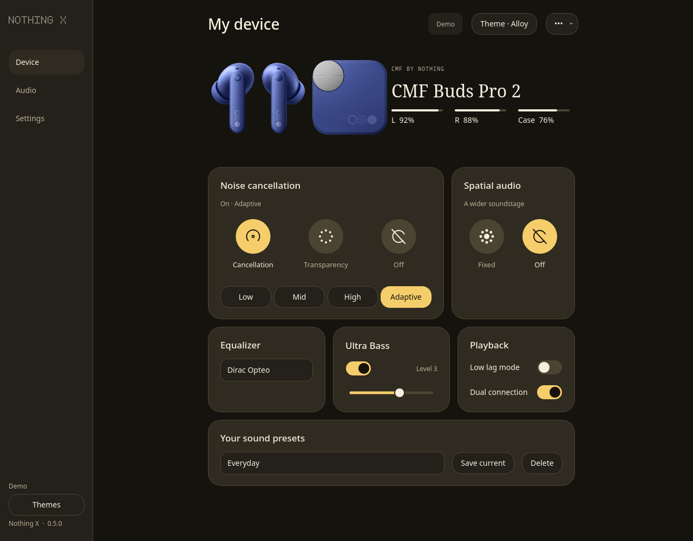 | 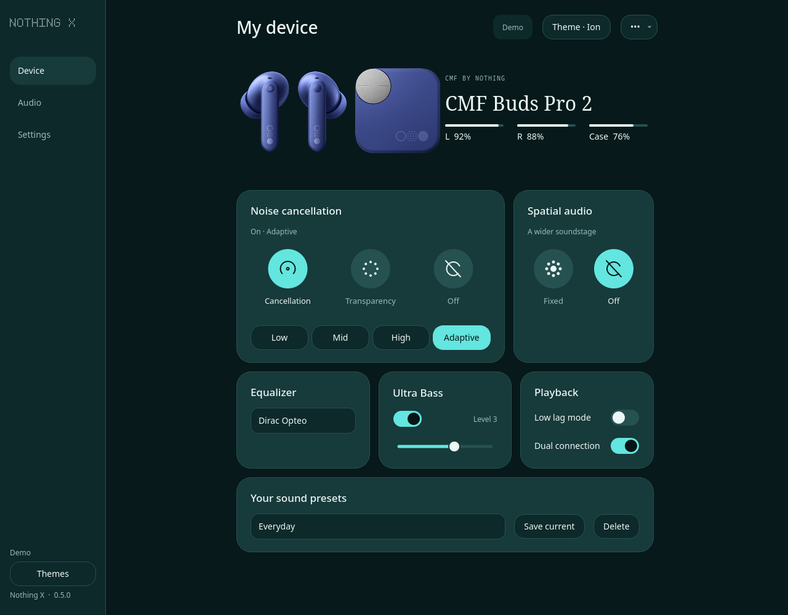 |

</details>

The screenshots show the 0.5 desktop preview using simulated data. The published packages currently represent the earlier public release.

## Why it exists

Nothing and CMF devices expose useful controls through their phone companion app, while Linux desktop users also need quick access to audio routing, Bluetooth profiles, and device status. Nothing X brings those workflows together in one focused desktop interface instead of splitting them across the phone and system settings.

## Choose a build

The same UI is available with two native backends and three distribution methods: six variants in total.

| Distribution | C++ + Python/Cython | Rust + Python/Cython |
| --- | --- | --- |
| Portable Linux app | [C++ AppImage](https://github.com/basanta-bhandari/Nothing-x/releases/latest/download/NothingX-cpp-x86_64.AppImage) | [Rust AppImage](https://github.com/basanta-bhandari/Nothing-x/releases/latest/download/NothingX-rust-x86_64.AppImage) |
| COSMIC panel applet | `--backend cpp` | `--backend rust` |
| Clone and run | `./run-cpp.sh` | `./run-rust.sh` |

Published AppImages target Linux x86-64 and are built on CachyOS. To run one, make it executable and launch it:

```bash
chmod +x NothingX-cpp-x86_64.AppImage
./NothingX-cpp-x86_64.AppImage
```

macOS `.app` and `.dmg` build scripts are included, although prebuilt Mac packages and hardware validation are still pending.

## Run from source

On CachyOS or Arch Linux:

```bash
sudo pacman -S --needed git python python-pip base-devel cmake pkgconf json-c bluez bluez-utils pipewire-pulse wireplumber
sudo systemctl enable --now bluetooth

git clone https://github.com/basanta-bhandari/Nothing-x.git
cd Nothing-x
./setup.sh --backend cpp
./run-cpp.sh
```

`setup.sh` creates `.venv`, installs Python requirements, and builds the selected engine. Pair the device in system Bluetooth settings before opening the app.

For Rust, install [Rust](https://www.rust-lang.org/tools/install) 1.85 or newer, then use `./setup.sh --backend rust` and `./run-rust.sh`. Use `--backend all` to build both engines.

Run the desktop UI with simulated data:

```bash
./run-cpp.sh --demo
```

Install a searchable desktop entry:

```bash
.venv/bin/python install-local.py --backend cpp
```

Build and install the current COSMIC applet with Rust 1.93 or newer:

```bash
.venv/bin/python tools/build_applets.py --backend cpp
.venv/bin/python install-cosmic.py --backend cpp
```

Replace `cpp` with `rust` for the other backend, then add **Nothing X** in COSMIC Settings → Desktop → Panel → Applets.

## How it is built

| Layer | Technology |
| --- | --- |
| Desktop interface | [Python](https://www.python.org/) 3.11+, [PySide6 / Qt Widgets](https://doc.qt.io/qtforpython-6/), and [Cython](https://cython.org/) |
| Device engines | C++20 with [json-c](https://github.com/json-c/json-c), or Rust |
| Bluetooth | [BlueZ](https://www.bluez.org/), nonblocking RFCOMM sockets, and the Qt event loop |
| Audio | [PipeWire](https://pipewire.org/), its PulseAudio interface, and [WirePlumber](https://pipewire.pages.freedesktop.org/wireplumber/) |
| COSMIC applet | Rust and [libcosmic](https://github.com/pop-os/libcosmic) |
| Packaging | [CMake](https://cmake.org/), Cargo, Cython, and [PyInstaller](https://pyinstaller.org/) |

The window and panel applet share a local service. That service owns device communication and state while the UI renders controls and receives updates. This keeps a single device connection alive even when the full window and applet are both open.

The main engineering work focused on making a desktop-first experience feel coherent:

| Problem | Solution |
| --- | --- |
| Controls felt crowded | Grouped them into Device, Audio, and Settings, with a shorter panel experience. |
| Window and panel competed for connections | Moved connection ownership into one independent local service. |
| Audio changes made the UI refresh too often | Filtered self-generated events and coalesced frequent slider updates. |
| Case battery and widgets looked inconsistent | Cached reported readings, labelled stale values, and used shared switch and slider components. |

## Development and packaging

For Python-only UI iteration, use:

```bash
./setup.sh --backend cpp --no-cython
```

After editing compiled UI modules, rebuild them with:

```bash
.venv/bin/python setup.py build_ext --inplace
```

Rebuild an engine with `.venv/bin/python tools/build_backends.py --backend cpp` or `rust`.

Run the device-service regression checks against each built engine:

```bash
NOTHINGX_BACKEND=cpp .venv/bin/python tests/test_beta.py -v
NOTHINGX_BACKEND=rust .venv/bin/python tests/test_beta.py -v
NOTHINGX_BACKEND=cpp .venv/bin/python tests/test_ui.py -v
NOTHINGX_BACKEND=rust .venv/bin/python tests/test_ui.py -v
```

These checks use simulated transports and cover fragmented responses, request ordering, timeouts, reconnect queues, locator deadlines, and every model profile. They do not connect to physical devices. Hardware testing is still needed for firmware-specific behavior and macOS.

Key directories:

- [`nothingx/`](nothingx/) — UI, audio integration, and local service
- [`native/`](native/) — C++ engine
- [`rust-engine/`](rust-engine/) — Rust engine
- [`cosmic-applet/`](cosmic-applet/) — COSMIC panel applet

For an AppImage, install [appimagetool](https://github.com/AppImage/appimagetool), then run:

```bash
.venv/bin/python -m pip install -r requirements-build.txt
packaging/build-appimage.sh cpp
```

On macOS, install Python, CMake, pkg-config, json-c, and Rust, for example with [Homebrew](https://brew.sh/). Run the same setup command, then build a disk image with:

```bash
.venv/bin/python packaging/build-macos.py --backend cpp
```

Licensed under [MIT](LICENSE). See [NOTICE](NOTICE) for assets and dependencies. Nothing X is not affiliated with Nothing or CMF.
