# Nothing X

Nothing and CMF audio controls for Linux, with a native COSMIC panel applet.

[Try the browser demo](https://basanta-bhandari.github.io/Nothing-x/) · [Published downloads](https://github.com/basanta-bhandari/Nothing-x/releases/latest)


An unofficial desktop companion for adjusting your earbuds or headphones without reaching for your phone. It started with **CMF Buds Pro 2 on CachyOS/COSMIC**, then grew into a shared interface for other Nothing and CMF models.

- **Device controls:** noise cancellation, transparency, EQ, Ultra Bass, spatial audio and model-specific settings.
- **Desktop audio:** volume, balance, Bluetooth profiles, microphones and application routing through PipeWire.
- **Personal settings:** saved sound presets, desktop device names, six themes, startup preferences and version-aware updates.
- **Quick access:** battery readings and essential controls from the COSMIC panel.

Controls depend on the model and firmware. CMF Buds Pro 2 is the primary development device; other catalog profiles have not all been verified on hardware. Case readings are cached and marked **Last reported** when unavailable.

## Screenshots

<table>
<tr>
<td>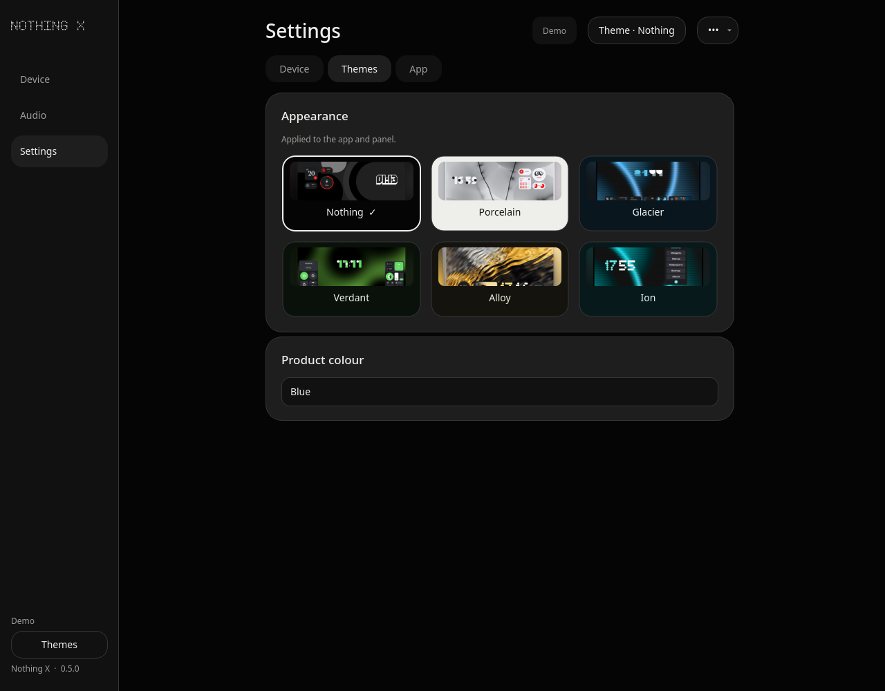<br><b>Themes</b> — Nothing, Porcelain, Glacier, Verdant, Alloy and Ion.</td>
<td>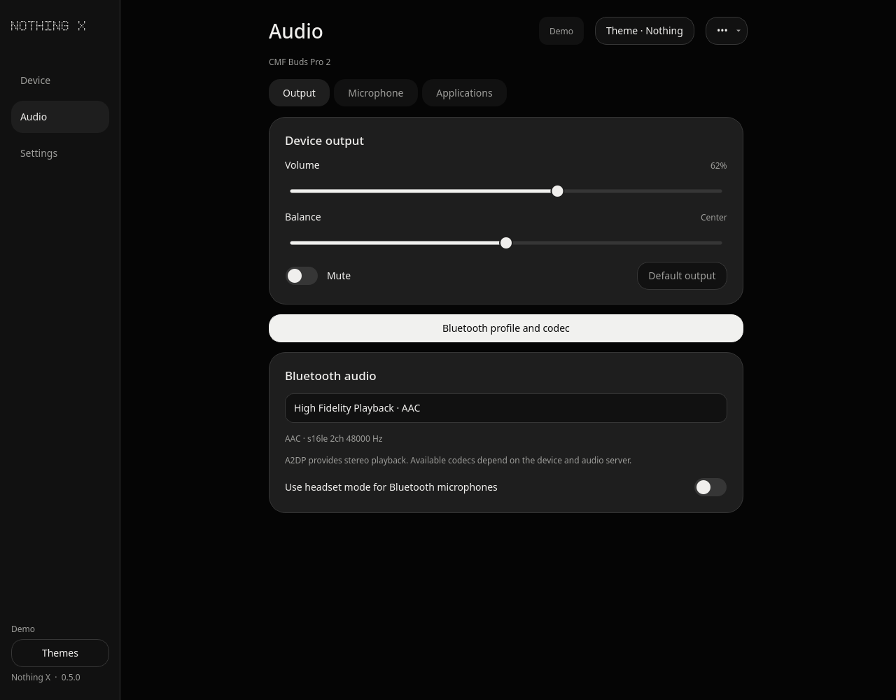<br><b>Audio</b> — output controls and available Bluetooth profiles.</td>
</tr>
<tr>
<td>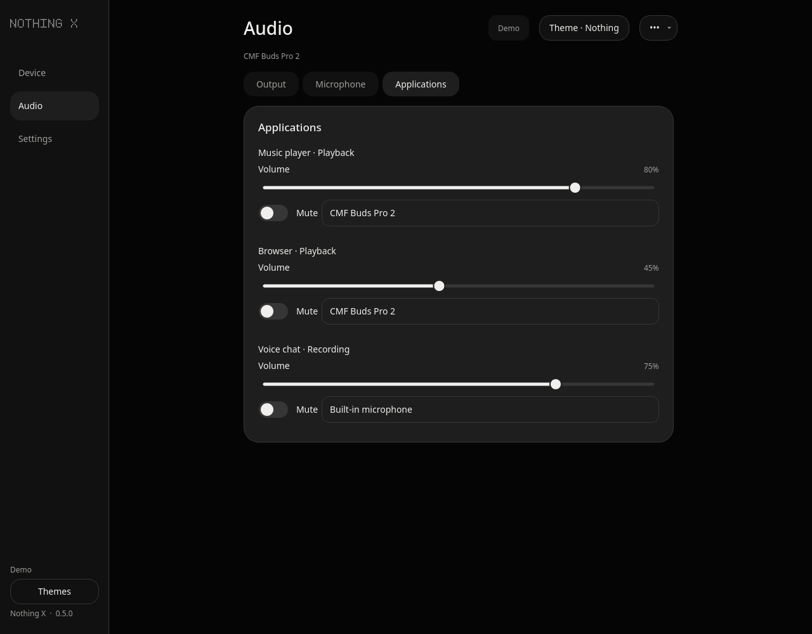<br><b>Application routing</b> — choose where each stream goes.</td>
<td>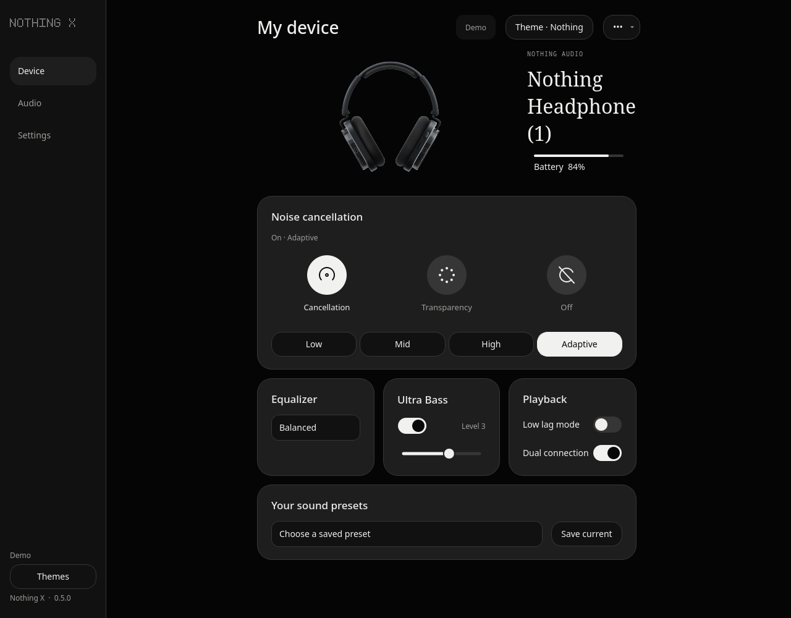<br><b>Headphones</b> — the same interface adapts to the device.</td>
</tr>
</table>

<details>
<summary>See every theme, microphone controls and device settings</summary>

<table>
<tr>
<td><br>Nothing</td>
<td>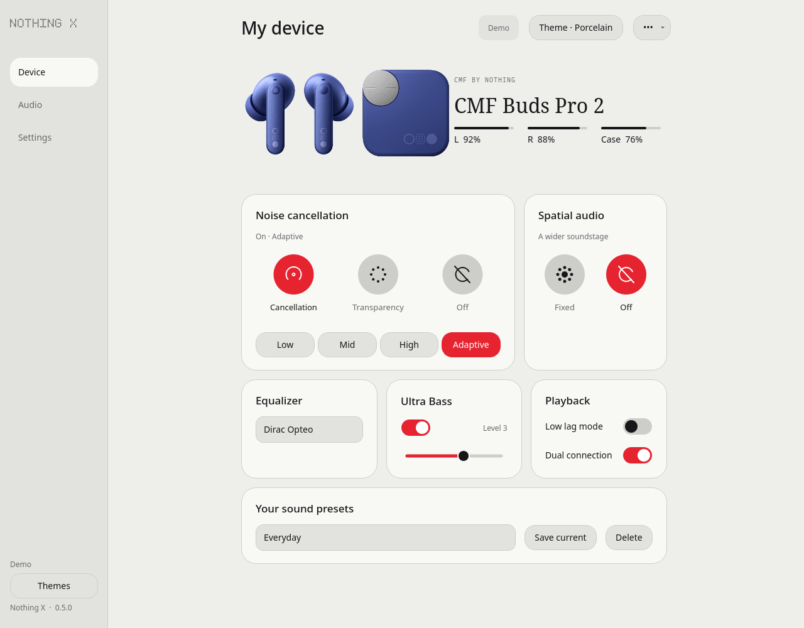<br>Porcelain</td>
<td>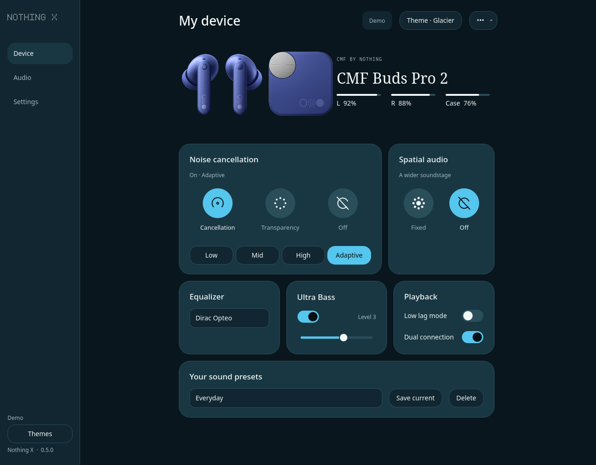<br>Glacier</td>
</tr>
<tr>
<td>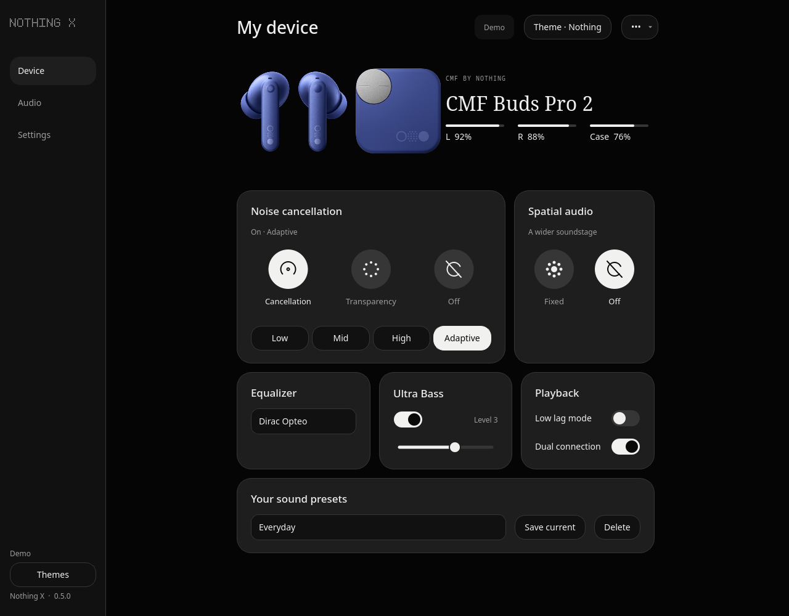<br>Verdant</td>
<td>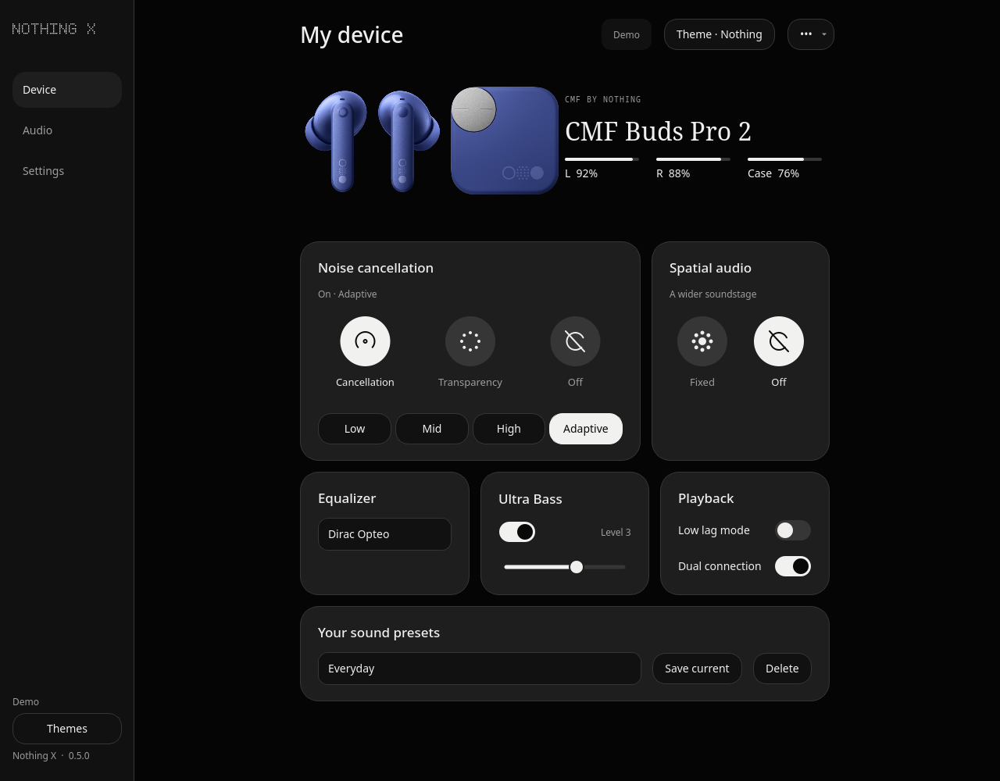<br>Alloy</td>
<td>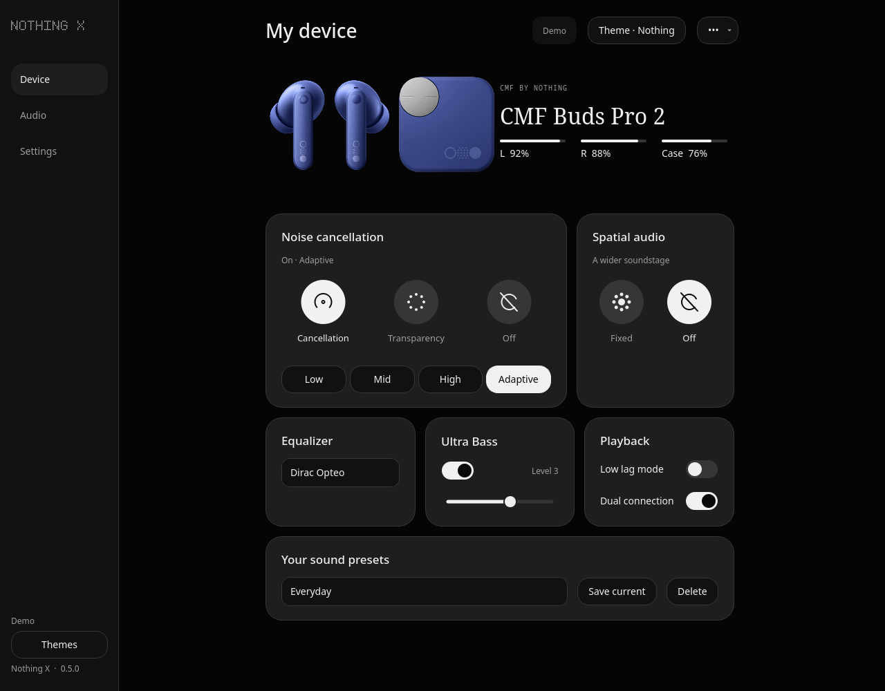<br>Ion</td>
</tr>
</table>

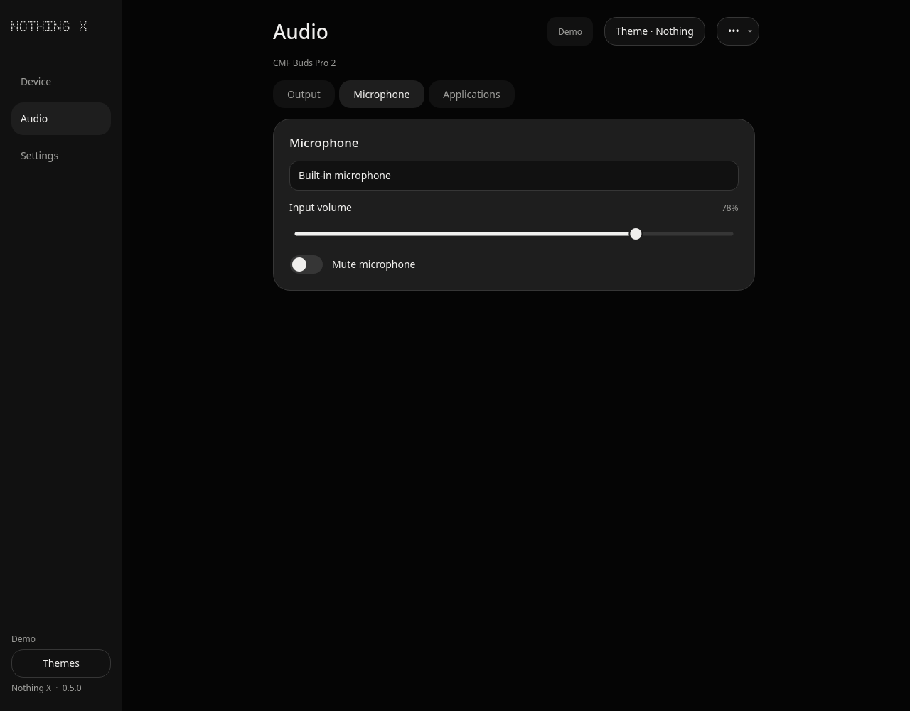
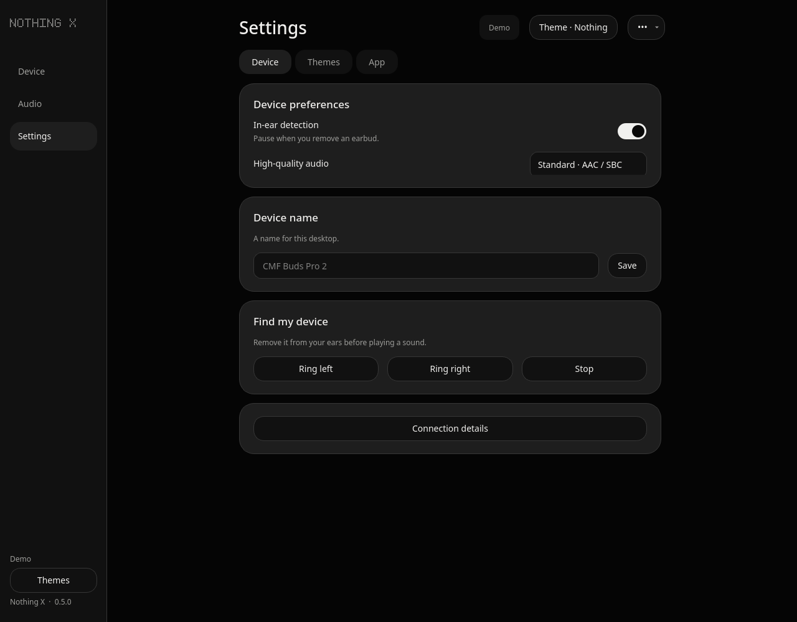

</details>

Screenshots use simulated data and show the **0.5 desktop preview**. Published packages and the browser demo currently use the earlier release. The demo lets you explore simulated controls without downloading anything or connecting hardware.

## Choose a version

One interface, two interchangeable native backends, three distributions: **six variants**.

| Distribution | C++ + Python/Cython | Rust + Python/Cython |
| --- | --- | --- |
| Portable Linux app | [C++ AppImage](https://github.com/basanta-bhandari/Nothing-x/releases/latest/download/NothingX-cpp-x86_64.AppImage) | [Rust AppImage](https://github.com/basanta-bhandari/Nothing-x/releases/latest/download/NothingX-rust-x86_64.AppImage) |
| COSMIC panel applet | `--backend cpp` | `--backend rust` |
| Clone and run | `./run-cpp.sh` | `./run-rust.sh` |

Published AppImages are Linux x86-64 builds made on CachyOS. Older distributions may need a source build. macOS `.app`/`.dmg` build support is included, but Mac packages and hardware validation are still pending.

To run a downloaded AppImage, make it executable with `chmod +x NothingX-cpp-x86_64.AppImage`, then run `./NothingX-cpp-x86_64.AppImage` (substitute `rust` for the Rust build).

## Run from source

On CachyOS or Arch Linux:

```bash
sudo pacman -S --needed git python python-pip base-devel cmake pkgconf json-c bluez bluez-utils pipewire-pulse wireplumber
sudo systemctl enable --now bluetooth

git clone https://github.com/basanta-bhandari/Nothing-x.git
cd Nothing-x
./setup.sh --backend cpp
./run-cpp.sh
```

Setup creates `.venv`, installs the Python dependencies and builds the selected backend. Pair and connect your device in system Bluetooth settings first.

For the Rust variant, install [Rust](https://www.rust-lang.org/tools/install) 1.85 or newer, run `./setup.sh --backend rust`, then `./run-rust.sh`. Use `--backend all` during setup to build both engines.

To explore the desktop interface without connecting earbuds:

```bash
./run-cpp.sh --demo
```

To add the full app to your application launcher:

```bash
.venv/bin/python install-local.py --backend cpp
```

For the current COSMIC applet, build with **Rust 1.93+**, then install:

```bash
.venv/bin/python tools/build_applets.py --backend cpp
.venv/bin/python install-cosmic.py --backend cpp
```

Replace `cpp` with `rust` for the other variant. Add **Nothing X** in COSMIC Settings → Desktop → Panel → Applets.

**In the app:** use **Theme** at the top right for appearance, **Audio** for Output/Microphone/Applications, and **Settings → App** for startup and updates.

## Stack and design

| Part | Tools |
| --- | --- |
| Desktop UI | [Python](https://www.python.org/) 3.11+, [PySide6 / Qt Widgets](https://doc.qt.io/qtforpython-6/), [Cython](https://cython.org/) |
| Native protocol engines | C++20 with [json-c](https://github.com/json-c/json-c), or Rust |
| Linux connections | [BlueZ](https://www.bluez.org/), nonblocking RFCOMM sockets and Qt's event loop |
| Linux audio | [PipeWire](https://pipewire.org/), its PulseAudio interface and [WirePlumber](https://pipewire.pages.freedesktop.org/wireplumber/) |
| COSMIC applet | Rust and [libcosmic](https://github.com/pop-os/libcosmic) |
| Builds | [CMake](https://cmake.org/), Cargo, Cython and [PyInstaller](https://pyinstaller.org/) |

The UI and panel talk to one local control service. That service uses the selected native engine for device messages and state, keeping presentation separate from connection handling.

The project grew through practical fixes:

| Challenge | Approach |
| --- | --- |
| Too many controls competing for attention | Focused Device, Audio and Settings sections; compact panel controls. |
| Connection races when opening or closing windows | An independent service, shared messaging and exclusive ownership of its socket. |
| Repeated audio refreshes causing unnecessary work | Filter self-generated events, coalesce slider changes and publish changed state. |
| Missing case readings and inconsistent controls | Cache reported battery values, label stale readings and standardize switch/slider behavior. |

<details>
<summary>Development and packaging</summary>

Use `./setup.sh --backend cpp --no-cython` on a fresh checkout for Python-only UI iteration. After editing already-compiled UI modules, rebuild them with:

```bash
.venv/bin/python setup.py build_ext --inplace
```

Rebuild an engine with `.venv/bin/python tools/build_backends.py --backend cpp` or `rust`.

The main source areas are [`nothingx/`](nothingx/) for the UI/service, [`native/`](native/) for C++, [`rust-engine/`](rust-engine/) for Rust, and [`cosmic-applet/`](cosmic-applet/) for the panel.

For Linux AppImages, install [appimagetool](https://github.com/AppImage/appimagetool) and the build requirements:

```bash
.venv/bin/python -m pip install -r requirements-build.txt
packaging/build-appimage.sh cpp
```

On a Mac, install Python, CMake, pkg-config, json-c and Rust as needed, for example through [Homebrew](https://brew.sh/). Run the same setup command; it creates a local app bundle. To build a disk image on that Mac:

```bash
.venv/bin/python packaging/build-macos.py --backend cpp
```

Use `rust` instead of `cpp` to build the other variant.

</details>

Licensed under [MIT](LICENSE). See [NOTICE](NOTICE) for assets and dependencies. This project is not affiliated with Nothing or CMF.
