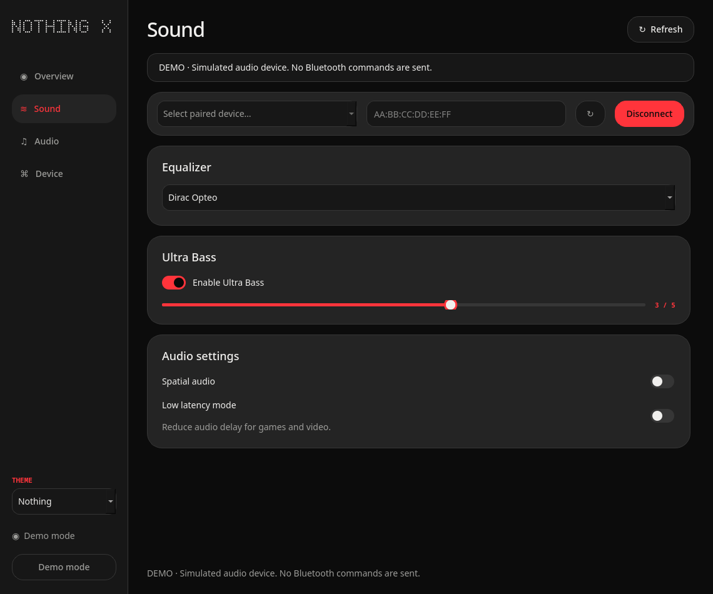

# Nothing X for Linux & macOS

An unofficial desktop companion for Nothing and CMF audio devices, built to put the controls that normally live on a phone within reach of your desktop. It was developed around CMF Buds Pro 2 and has device profiles for Nothing earbuds, headphones and other CMF models.

[Try the interactive preview](https://basanta-bhandari.github.io/Nothing-x/) · [Downloads](https://github.com/basanta-bhandari/Nothing-x/releases/latest)


Control noise cancellation, equalizer presets, bass, spatial audio and device settings; see battery levels; find your device; and manage Bluetooth profiles, volume and audio routing. The available controls depend on the model and what it reports. Other device profiles have not all been verified on hardware.

Six themes are included: Nothing, Porcelain, Glacier, Verdant, Alloy and Ion.

<table>
<tr><td></td><td></td><td></td></tr>
<tr><td></td><td></td><td></td></tr>
</table>

<details><summary>More screenshots</summary>




</details>

## Choose a version

The same interface is available with either native backend. Pick one backend and one distribution:

| Distribution | C++ + Python | Rust + Python |
| --- | --- | --- |
| Portable | [Linux AppImage](releases/NothingX-cpp-x86_64.AppImage) | [Linux AppImage](releases/NothingX-rust-x86_64.AppImage) |
| COSMIC panel applet | `--backend cpp` | `--backend rust` |
| Git clone and run scripts | `./run-cpp.sh` | `./run-rust.sh` |

AppImage is a Linux format. macOS `.app` and `.dmg` build scripts are included for both backends; prebuilt Mac packages are not yet available. The browser preview demonstrates the interface with simulated settings and does not connect to hardware.

## Run from source

On CachyOS or Arch Linux, install the build and Bluetooth/audio dependencies:

```bash
sudo pacman -S --needed base-devel cmake pkgconf json-c python python-pip rust bluez bluez-utils pipewire-pulse wireplumber
sudo systemctl enable --now bluetooth

git clone https://github.com/basanta-bhandari/Nothing-x.git
cd Nothing-x
./setup.sh --backend cpp
./run-cpp.sh
```

For the Rust backend, replace `cpp` with `rust` in the setup command and run `./run-rust.sh`. Setup creates a project-local Python environment and builds the selected native library. Use `./setup.sh --backend all` to build both. Pair and connect the device in your system Bluetooth settings first.

To install the full app in your application launcher:

```bash
.venv/bin/python install-local.py --backend cpp
```

To install the COSMIC applet and its searchable settings app:

```bash
.venv/bin/python install-cosmic.py --backend cpp
```

Choose `rust` instead of `cpp` for the other variant. Add **Nothing X** from COSMIC Settings → Desktop → Panel → Applets. The supplied applets target x86-64; to rebuild them, use Rust 1.93 or newer and `python tools/build_applets.py --backend all`.

For an AppImage, download a Linux x86-64 build, make it executable, and open it. These builds were made on CachyOS; older distributions may need to build from source:

```bash
chmod +x NothingX-cpp-x86_64.AppImage
./NothingX-cpp-x86_64.AppImage
```

On macOS, install Python, CMake, pkg-config, json-c and Rust (for example with [Homebrew](https://brew.sh/)), then run the same clone and setup commands. `./run-cpp.sh` or `./run-rust.sh` opens a local app bundle. Build a disk image with `.venv/bin/python packaging/build-macos.py --backend cpp` (or `rust`). macOS support still needs hardware validation.

## Everyday use

- **Startup and updates:** open Device settings to enable startup or check for a release matching your backend and distribution.
- **Case battery:** the case can report its last level when it is open with a bud inside; a dash means a current reading is unavailable. The panel number is the lower reported earbud percentage.
- **Audio:** Linux audio controls use PipeWire's PulseAudio interface and WirePlumber. Codec and microphone options depend on the device and system.
- **Themes:** choose one in the sidebar or panel. The preference is shared between them.

## Built with

The shared interface uses [Python](https://www.python.org/), [PySide6 / Qt](https://doc.qt.io/qtforpython-6/) and [Cython](https://cython.org/). C++20 and [Rust](https://www.rust-lang.org/) provide interchangeable native protocol engines; Bluetooth uses Qt and [BlueZ](https://www.bluez.org/) on Linux, with [PipeWire](https://pipewire.org/) and [WirePlumber](https://pipewire.pages.freedesktop.org/wireplumber/) for audio. The COSMIC panel applet uses Rust and [libcosmic](https://github.com/pop-os/libcosmic).

The main challenges were keeping controls responsive during Bluetooth communication, reconciling delayed battery reports, sharing a connection between the panel and settings window, and packaging the same interface for different systems. Device requests and Linux audio queries run asynchronously, while the applet hands off its control connection when full settings opens.

Licensed under [MIT](LICENSE); see [NOTICE](NOTICE) for asset and dependency information. Nothing and CMF are trademarks of their respective owners.
